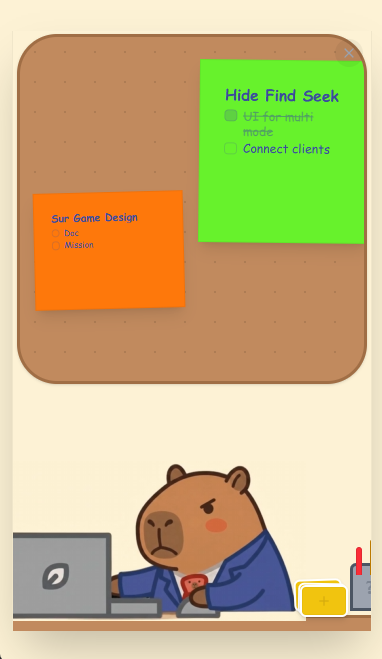

# 🦦 CapNote - Sticky Notes for Productivity

[](https://vitejs.dev/)
[](https://reactjs.org/)
[](https://www.electronjs.org/)
[](https://tailwindcss.com/)

**CapNote** is a cute and powerful sticky notes application built on top of Electron. Featuring a friendly Capybara-themed interface, it helps you manage your daily tasks in a visual, dynamic, and inspiring way.

---

## 📸 Demo



---

## ✨ Key Features

- 📝 **Smart Sticky Notes**: Create unlimited sticky notes to keep your workspace organized.
- 🎨 **Flexible Customization**: Change colors (preset or custom HEX codes) and category icons (Home, Work, Book, Nature).
- 🔄 **Fluid Interaction**: 
  - Easy Drag & Drop using the right mouse button.
  - Interactive resizing to fit your content.
  - Smooth animations powered by Framer Motion.
- ✅ **Integrated To-Do Lists**: Built-in checklists within each note to track your progress.
- 💾 **Automatic Persistence**: Your data is saved locally, ensuring privacy and instant availability.
- 🐹 **Chill UI Experience**: Animated Capybaras and a warm color palette to reduce work stress.

---

## 🛠️ Tech Stack

Built with the latest modern web technologies:

- **Frontend**: React 19, Vite, Tailwind CSS v4.
- **Desktop Runtime**: Electron.
- **Animation**: Framer Motion.
- **Icons**: Lucide React.
- **AI Integration**: Google Generative AI (Gemini ready).

---

## 🚀 Getting Started

### Prerequisites
- [Node.js](https://nodejs.org/) (Version 18 or higher)
- [npm](https://www.npmjs.com/) or [yarn](https://yarnpkg.com/)

### Installation Steps

1. **Clone the repository:**
   ```bash
   git clone https://github.com/your-username/capybara-note.git
   cd capybara-note
   ```

2. **Install dependencies:**
   ```bash
   npm install
   ```

3. **Run in development mode:**
   ```bash
   # Run Vite dev server
   npm run dev
   
   # Start Electron (in a separate terminal)
   npm run electron:start
   ```

4. **Package the application (Build):**
   ```bash
   npm run electron:build
   ```
   The installer will be generated in the `release/` directory.

---

## 💡 How to Use

- **Left Click**: Click a note to edit the title, content, or checklist items.
- **Right Click**: Hold and drag to move notes around the board.
- **Corner Handles**: Drag the bottom/right edges to resize the note.
- **Plus (+) Button**: Click the floating notes next to the Capybara to create a new sticky note.

---

## 📜 License

This project is licensed under the **Apache-2.0** License.

---

*Made with Tundayne❤️ and Capybaras.*
